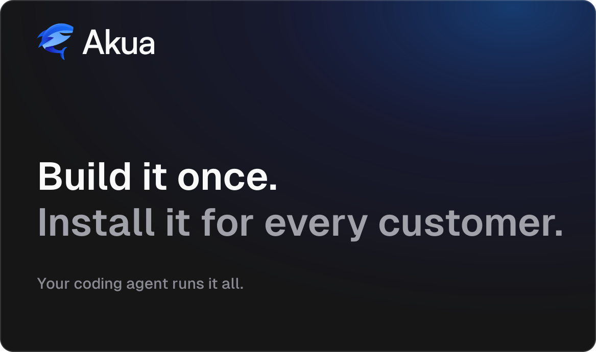

<!-- markdownlint-disable MD033 MD041 -->

  

  <a href="https://akua.dev">Website</a>
  ·
  <a href="https://docs.akua.dev">Docs</a>
  ·
  <a href="https://docs.akua.dev/quickstart">Quickstart</a>
  ·
  <a href="https://github.com/akua-dev/akua">CLI</a>

**Build it once. Install it for every customer.**

Each customer gets their own install, on a server run by Akua or on their own.
Every one stays up to date. Your coding agent runs it all.

Akua is for builders - agencies, freelancers, consultants and small product
teams - who build software for customers with coding agents.

## Start with your coding agent

Paste the prompt from the [Quickstart](https://docs.akua.dev/quickstart) into
your coding agent. It installs the CLI, signs you in and sets Akua up with you.

## Open source

- [akua-dev/akua](https://github.com/akua-dev/akua) - the open-source Akua CLI
  and `akuapkg`, the typed package tool.
- [akua-dev/homebrew-tap](https://github.com/akua-dev/homebrew-tap) - install
  with `brew install akua-dev/tap/akua`.

## Learn more

- [akua.dev](https://akua.dev) - the product.
- [Docs](https://docs.akua.dev) - concepts, workflows and the API reference.
